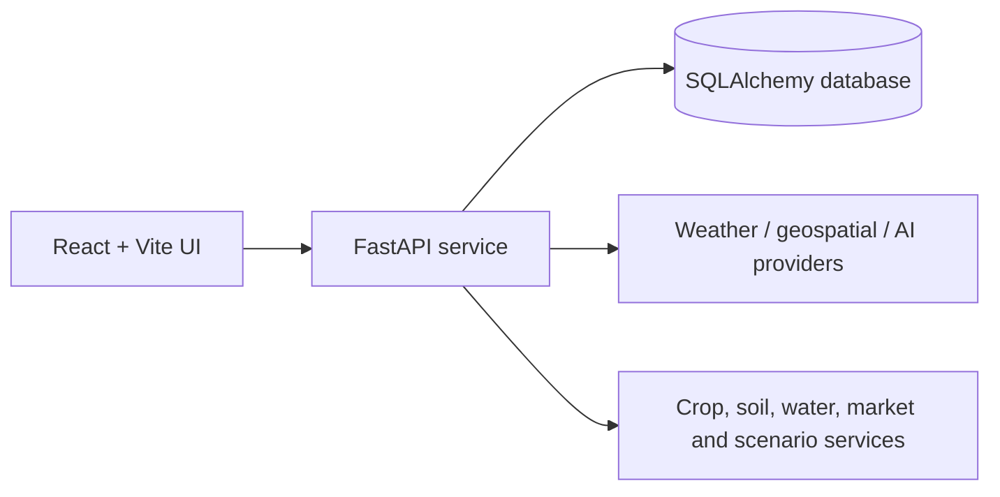

# AquaShift

**AquaShift** is a full-stack agricultural decision-support prototype. A Python API organizes crop, soil, water, weather, market, geospatial, optimization, and reporting workflows; a React application presents maps and analytics around those services.

## Problem and scope

The project explores how farm-planning decisions can combine environmental and market context rather than relying on isolated dashboards. It is a software prototype; its recommendations should not be treated as agronomic advice without validating the underlying data and models.

## Features in the source

- Versioned API modules for crops, soil, water, weather, market, geospatial data, insights, predictions, optimization, reports, and scenarios.
- Service modules for geospatial, AI-assisted insight, and provider integrations.
- React interface with Leaflet maps and Recharts visualizations.
- Docker Compose configuration, backend and frontend Dockerfiles, and a Windows launcher.

## Architecture



## Repository layout

- `backend/app/api/v1/` — API router and endpoint modules.
- `backend/app/services/` — domain and external-provider services.
- `backend/app/models/`, `schemas/`, and `db/` — data models, validation, and database setup.
- `frontend/src/` — React application.
- `docker-compose.yml` — local multi-service configuration.

## Run locally

Docker is the simplest documented entry point:

```bash
docker compose up --build
```

On Windows, `start_platform.ps1` is also present. Review it and `docker-compose.yml` for ports and startup behavior before running. For separate development, install backend dependencies from `backend/requirements.txt` and frontend dependencies from `frontend/package.json`; the frontend scripts include `dev`, `build`, `lint`, and `preview`.

## Configuration and API

Start from `backend/.env.example`; copy it to `backend/.env` and supply only the database and provider credentials needed for your setup. Keep actual keys out of Git. Endpoint schemas and route definitions live under `backend/app/api/v1/endpoints/`; the router is in `backend/app/api/v1/router.py`.

## Deployment and next steps

Docker assets are present, but no production deployment target is declared. A useful next step is to document sample inputs, data provenance, model assumptions, and API examples. No repository-level `LICENSE` file was found, so reuse terms for project code are unspecified.
